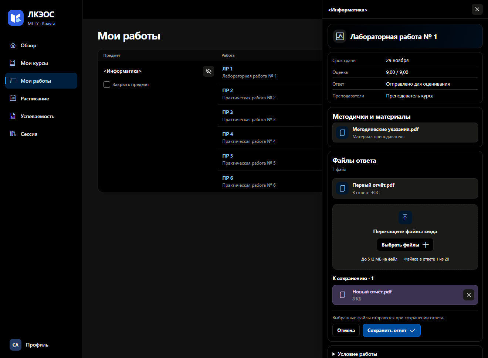

# ЛКЭОС

Личный кабинет для студентов Калужского филиала МГТУ им. Н. Э. Баумана. В одном окне можно открыть методичку, сдать лабораторную, посмотреть следующую пару и проверить оценку. Курсы и задания загружаются из ЭОС, расписание и оценки из ЛКС.

**[Скачать для Windows](https://github.com/Nexerium/LKEOS/releases/download/v1.0/LKEOS-1.0-win-x64.exe)** · **[Релиз 1.0](https://github.com/Nexerium/LKEOS/releases/tag/v1.0)**


## Первый запуск

1. Скачайте `LKEOS-1.0-win-x64.exe` и запустите его на Windows x64. Для встроенного окна входа нужен [Microsoft Edge WebView2 Runtime](https://developer.microsoft.com/microsoft-edge/webview2/). Среда .NET уже входит в сборку.
2. Откройте **Профиль**. Выберите существующий локальный профиль или создайте новый. Чтобы включить автовход, сохраните логин и пароль МГТУ и включите переключатель «Автовход».
3. Нажмите **Войти**. Приложение последовательно откроет официальные формы ЭОС и ЛКС. Состояние каждого подключения видно в профиле. Для получения данных нужен интернет.

## Учёба

| Раздел | Что можно сделать |
| --- | --- |
| **Обзор** | Вернуться к пяти последним открытым работам. Календарь показывает учебную неделю, числитель или знаменатель и события выбранного дня. |
| **Мои курсы** | Найти курс по названию, открыть его темы и материалы. Курсы можно скрывать и возвращать. Рядом с названием закрытого предмета появляется зелёная галочка. |
| **Мои работы** | Открыть лабораторную или практику из общей таблицы. В боковой карточке видны условие, сроки, преподаватель, методички, отправленные файлы и оценка, если эти сведения есть в ЭОС. |
| **Расписание** | Посмотреть пары группы **ИУК6-51** для своей подгруппы. Числитель и знаменатель стоят рядом, еженедельная пара занимает обе колонки. Указаны время, преподаватели и аудитории. |
| **Успеваемость** | Посмотреть ведомость ЛКС по дисциплинам и неделям. Нажатие на отметку открывает подробности. При повторном переходе таблица открывается сразу. Кнопка «Обновить» загружает свежие данные. |
| **Сессия** | Посмотреть результаты экзаменов и зачётов, выбрать один семестр или показать все. Таблица включает дисциплину, вид аттестации, часы и оценку. |

### Как сдать лабораторную

Откройте работу на главной или в **Моих работах**. В карточке скачайте методичку и нажмите **Редактировать ответ**, если ЭОС разрешает редактирование. Перетащите файл в область загрузки или выберите его на компьютере. Перед отправкой можно проверить список вложений и ограничения задания. Кнопка **Сохранить ответ** отправляет файлы в ЭОС.

<details>
<summary>Посмотреть карточку работы и загрузку файлов</summary>



</details>

Личная галочка помогает отмечать выполненные работы. Если ЭОС ещё не подтвердила отправку, приложение попросит подтвердить изменение галочки. В карточке можно вернуть отметку из ЭОС. Закрыть предмет целиком можно в **Моих работах**. Скрытие предмета из этой таблицы действует только на таблицу.

## Профиль и оформление

* Для нескольких учётных записей можно создать отдельные профили, переключаться между ними, переименовывать и удалять их.
* ЭОС и ЛКС используют общий логин МГТУ. Пароль хранится в Диспетчере учётных данных Windows. Для каждого профиля приложение ведёт отдельные сессии сервисов.
* При включённом автовходе ЭОС подключается при запуске. Личный раздел ЛКС подключается при открытии успеваемости или результатов сессии. В профиле доступны общие кнопки входа, обновления и отключения.
* Светлая и тёмная темы переключаются в профиле. Поиск по курсам и заданиям открывается сочетанием **Ctrl + K**.

## Сборка из исходников

Приложение использует C#, WPF и WebView2. Интерфейс написан на HTML, CSS и JavaScript. Для сборки нужны Windows, .NET 8 SDK и доступ к NuGet.

```powershell
dotnet publish KalugaCampus.csproj -c Release -r win-x64 --self-contained true -p:PublishSingleFile=true -p:IncludeNativeLibrariesForSelfExtract=true -p:EnableCompressionInSingleFile=true -o publish
```

Готовый файл будет в `publish/KalugaCampus.exe`.

ЛКЭОС является независимым студенческим проектом. Учебные данные предоставляют [ЭОС Калужского филиала](https://e-learning.bmstu.ru/kaluga/) и [Личный кабинет обучающегося МГТУ](https://lks.bmstu.ru/). Снимки экрана в README сделаны на тестовых данных.
